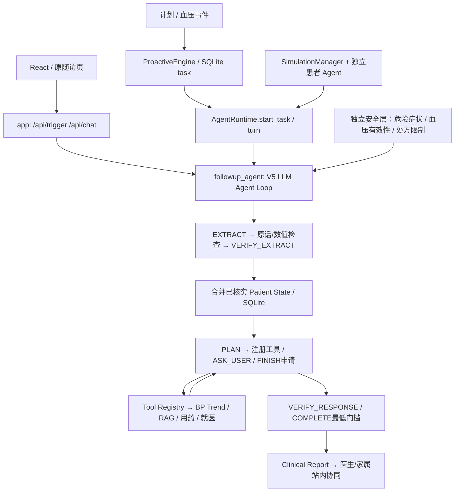

# V5 核心能力优化：修改前审查

日期：2026-10-15。基准：`cd94bb6`，当前分支 `main`，开始时工作区干净。本报告在本批源码修改前生成。检查本地真实代码而非据旧版 README 推断；上一批已将两个主模块改为中性名称，本批不重新建项目。

## 实际调用链与职责

其中 runtime 先提取并合并本轮输入再进入规划；图中提取步骤表示这一共同处理链，不代表每次 PLAN 重新提取。工具及对外回复独立验真，模型输出的信心不构成事实证据。

- 核心：`agent/followup_agent.py`、`state_manager.py`、`completion.py`、`clinical_report.py`；`backend/runtime_v5.py`、`model_client.py`、`proactive.py`、`simulation_v5.py`、`v5_api.py`。
- 共享：`extractor.py` 的 V5 转发/必要数值与安全辅助，`question_planner.py` 记录实际上一问，`reporting.py` 基础事实与紧急提示；医学工具、RAG、Memory、数据库各自承担现有职责。
- 兼容：V3 `planner.py/runner.py`、V4 分支、`backend/extraction.py`、`patient_state.py`、`db.py` 仍有接口/测试/旧会话消费者，不能按名称删除。
- 两条业务入口最终共享 V5 Loop，但 `app.py` 仍按环境开关选择旧版本，Runtime 固定 V5；不擅改历史版本标识、报告 schema 或 API 选择契约。

## 主要问题与实施优先级

| 优先级 | 真实证据 | 影响 | 本批最小处理 |
|---|---|---|---|
| P0 | runtime 在提取和验证结束后才首次保存本轮输入；验证期间模拟进程崩溃后 SQLite 中没有该输入 | 已接收回答或成功候选丢失，无法可靠恢复 | 接收输入、候选待验证、事实原子应用三个边界 checkpoint；复用 pending，不改问诊顺序 |
| P0 | runtime 将 medication_observations 写 SQLite 时丢弃 date，旧 app 路径反而保留实际服药日期 | 历史漏服变成仅有今日汇报时间，长期记忆难追溯 | 沿用已有 detail 日期标记，不迁移数据库表 |
| P0 | Visit Advice 的重复 unsafe_patterns 把“不要增加药物剂量”误判成加药指令 | 已通过 V5 复核的安全解释被整段替换、错误提升建议分级 | 复用现有否定感知处方守卫，补正/反例测试，临床风险阈值不变 |
| P1 | `_conversation` 同时包含 ASK_USER 和 AGENT_RESPONSE，且可能在尚无真实用户回复时冒充最新对话 | 重复上下文挤占近期问答，降低简短回答理解质量 | 按真实对话轮次保留一次已发布回复；不删除审计 Trace |
| P1 | V5 将历史工具拷进本轮结果，同时又提供 previous_tool_results | 相同结果重复注入 PLAN 和 VERIFY_RESPONSE | 结果按有效输入指纹复用、上下文只表达一次，保留必要反馈 |
| P1 | FINISH 被最低完成门槛拒绝后仍可不断复做相同 COMPLETE；自动恢复重置规划预算 | 成本叠加、无进展循环 | 缓存同一已核实上下文下的完成结果；任务执行累计预算/无进展反馈只限制成本，不选择临床问题 |
| P1 | 模拟 live 接受仅事实 ID 并标 canonical，可绕过自然回答语义相关性验证 | Mock/scripted 与真实患者能力混淆，可能答非所问 | live 必须提供可验的自然回答；scripted 显式区分；允许经过验证的无医学事实澄清 |
| P1 | 模拟恢复丢失已披露事实；不识别问题时脚本任取第一条候选，细节问题 fallback 可重复旧症状 | 回答不相关、重复，掩盖模型失败 | 从已保存且已验证的患者条目恢复披露；未知问题安全澄清、记录失败原因 |
| P1 | 当前评测有业务最低目标和真值校验，但缺独立成本/路径/不相关回复指标 | 覆盖率和链路成功容易被误解为自主性证明 | 保留原权重，新增客观 observations 与人工审阅项；分别报告三层测试 |
| P1 | 原 HTML 普通请求默认30秒、触发60秒、聊天90秒，短于多阶段模型处理可能耗时；缺 not_taken_yet/partially_completed；React结束后仍可输入 | 正常请求前端先失败，结束状态展示不一致 | 小范围接口时限和状态展示修复，不开发新前端 |

## 验证分层及边界

1. 数值、原话定位、工具参数和处方边界为程序硬检查；不靠正则理解一般患者语义。
2. 新患者医学事实仍由 DeepSeek 提取并独立 VERIFY_EXTRACT；已验证且原子应用的输入不再次提取。模型超时最多重试一次，成功候选优先再验证。
3. 对外沟通保留 VERIFY_RESPONSE 和违规反馈再生成；COMPLETE 负责一次目标评估，后端复核最低条件，不退化固定问题顺序。相同事实下已有结果可复用，事实变化后失效。
4. 工具仍由 LLM 按需选择，基于真实状态/知识版本指纹复用；不将知识片段写为患者事实。
5. Safety Layer、危险阈值、处方约束、来源注册、SQLite 表和医生/家属权限保持。暂停不算完成；部分完成和风险升级分别报告。

## 初始验证与执行安排

- 当前完整基线：603 项通过（7.831 秒）；React build/lint 通过。日志 `v5-optimization-baseline.log`，均为 Mock/离线验证。
- 分批实施：先输入/候选恢复和日期追溯，再上下文与完成判断，再模拟与评测、工具误拦/现有页面兼容，最后全链回归和真实 DeepSeek。
- 新增测试覆盖10类典型回答、同初始状态不同回答的自主路径、崩溃/超时/拒绝、事实与报告/消息幂等。Mock 只证明程序边界，scripted 只证明链路，真实模型独立统计。
- 不删除旧兼容模块，不引入框架/服务，不修改真实数据库、`.env` 和知识来源；不提交、推送、合并或开发额外平台功能。
- 多进程 SQLite 缓存/锁及生产部署不在本批范围。真实模型网络失败如实记录，不用脚本替代成功结论。
